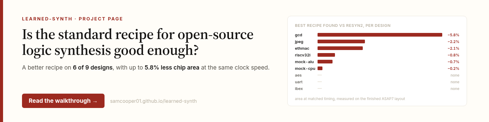
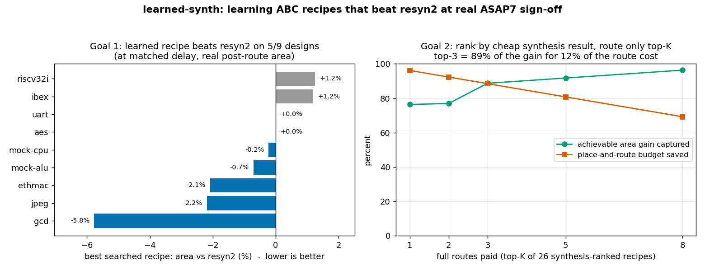

# learned-synth

**Is the standard recipe for open-source logic synthesis good enough? For most
designs, it can be improved: on 6 of 9 designs, a recipe chosen for that design beats
the standard recipe, `resyn2`, with up to 5.8% less chip area at the same clock speed,
verified by full chip layouts.**

<p align="center">
  <a href="https://samcooper01.github.io/learned-synth/"></a>
  <br>
  <b><a href="https://samcooper01.github.io/learned-synth/">&#8594; Read the full walkthrough</a></b>
</p>

Logic synthesis optimizes a design's logic one small step at a time, following a
recipe. [Yosys](https://yosyshq.net/yosys/) hands this job to
[ABC (And-Inverter Graph optimizer)](https://github.com/berkeley-abc/abc), and the
recipe never changes: a tiny controller and a large processor get exactly the same
steps. [`resyn2`](https://github.com/berkeley-abc/abc/blob/master/abc.rc#L111) is the
standard hand-tuned recipe that ships with ABC. This
project builds new recipes from the same classic transforms and grades every result on
a full chip layout through sign-off, with the open [OpenROAD](https://theopenroadproject.org/)
flow ([OpenROAD Flow Scripts](https://github.com/The-OpenROAD-Project/OpenROAD-flow-scripts))
on the [ASAP7 (Arizona State University 7nm predictive Process Design Kit)](https://github.com/The-OpenROAD-Project/asap7)
technology, instead of on the usual gate-count shortcut.



## The project in brief

1. **Machine learning on a proxy metric.** A PPO (Proximal Policy Optimization)
   reinforcement learning agent that builds a recipe one transform at a time, rewarded
   by AIG (And-Inverter Graph) node count; a GNN (Graph Neural Network) surrogate that
   predicts how much of an AIG `resyn2` would remove; and a greedy
   policy that picks each transform by the GNN's prediction.
   The learned recipes were then checked against post-route QoR (Quality of Results).
2. **Sign-off-graded design space exploration.** A harness that runs any recipe
   through the full RTL (Register Transfer Level)-to-sign-off flow (synthesis,
   placement, CTS (Clock Tree Synthesis), routing) at an iso-timing operating point: a
   per-design clock constraint calibrated so `resyn2` sits at near-zero slack. 25
   random recipes plus `resyn2` per design, 234 full layouts in total.
3. **A low-cost QoR predictor for search pruning.**
   Post-synthesis cell area, available in seconds, ranks candidate recipes before place
   and route, so only the top few are laid out.
4. **Surrogate-guided evolutionary search.** A genetic algorithm (elitism, tournament
   selection, crossover, mutation) that uses the post-synthesis surrogate as its
   fitness function, about 180 evaluations per design, then verifies its top 3
   candidates post-route.

## Results

| Design | Size (cells) | Best recipe versus `resyn2` | Found by |
|---|---|---|---|
| gcd | ~400 | 5.8% less area | random sample |
| jpeg | ~58,000 | 2.2% less area | random sample |
| ethmac | ~56,000 | 2.1% less area | random sample |
| riscv32i | ~8,600 | 0.8% less area, and meets timing where `resyn2` misses | directed search |
| mock-alu | ~11,000 | 0.7% less area, and meets timing where `resyn2` misses | random sample |
| mock-cpu | ~39,000 | 0.2% less area | random sample |
| aes | ~14,000 | no better recipe (a near miss: 5% smaller, under 1% of the clock late) | - |
| uart | ~750 | no better recipe | - |
| ibex | ~17,000 | no better recipe | - |

Every number comes from a full layout to sign-off at each design's iso-timing
clock: a recipe counts as better only if it meets timing and uses less area than
`resyn2` on the finished layout.

## How it works

1. **Running any recipe in the real flow ([harness/patch_orfs.py](harness/patch_orfs.py)).**
   A small, reversible patch makes the flow take any recipe file. A fixed opening step
   builds the logic graph, the searched middle is the list of transforms, and a fixed
   closing sequence maps the logic onto real library cells, so every comparison is like
   for like.
2. **The harness ([harness/harness.py](harness/harness.py)).** `run_recipe(design,
   recipe)` runs the full flow and records area, timing and power. Each recipe runs in
   its own output folder named from a fingerprint of its steps, and the raw
   measurements are kept so the definition of a win can change without re-running.
3. **Choosing the designs ([harness/probe_designs.py](harness/probe_designs.py)).** All
   12 example designs for this technology synthesize. aes-block fails floorplanning even
   in the unmodified flow, and the two largest processor cores were held out for layout
   time, leaving 9 designs from 418 to 58,336 cells
   ([results/DESIGN_SET.md](results/DESIGN_SET.md)).
4. **Matched-timing clocks ([harness/calibrate_clocks.py](harness/calibrate_clocks.py)).**
   At their shipped clocks, 6 of the 9 designs missed timing, which makes raw area
   unfair to compare. Each design's clock is calibrated by repeated full layouts to the
   fastest clock at which `resyn2` still just meets timing. A looser clock does not
   help: the tools stop working as hard and the slack disappears
   ([results/CLOCKS.md](results/CLOCKS.md)).
5. **The 234 layouts ([harness/labelsweep.py](harness/labelsweep.py)).** For each
   design, `resyn2` plus 25 random recipes run through the full flow at the matched
   clock: about 79 hours of compute in total, from about a minute per layout (uart) to
   about an hour (ethmac).
6. **Sharing one machine ([harness/loadmanaged_rerun.py](harness/loadmanaged_rerun.py)).**
   Each layout needs about 3.6 gigabytes of memory at its peak. The runner starts another
   layout only when one more fits in free memory above a reserve, staggers launches,
   never stops a running layout, and skips finished layouts when restarted.
7. **The cheap score and the directed search
   ([harness/predict_qor.py](harness/predict_qor.py),
   [harness/flagship_search.py](harness/flagship_search.py)).** The search runs 12
   rounds of 20 recipes, scored by synthesis only, and lays out its top 3 once at the
   end.

## Repository map

| Path | What |
|---|---|
| `docs/` | the project page and its images, plus a walkthrough of the default flow |
| `harness/harness.py` | runs one recipe through the full flow; the other scripts loop over it |
| `harness/` pipeline scripts | design selection through directed search, in the order under Reproduce |
| `harness/` `aig*`, `rl_env`, `train_rl`, `eval_policy`, `gnn_*`, `picker` | the earlier machine-learning studies |
| `results/` | every data file and write-up |
| `models/` | trained weights from the machine-learning studies |

## Reproduce

Requires an OpenROAD-flow-scripts checkout with the ASAP7 platform (set `LEARNED_SYNTH_ORFS`, or edit
`patch_orfs.DEFAULT_ORFS`), plus `numpy` and `matplotlib`.

```bash
cd harness
python3 probe_designs.py            # which designs synthesize cleanly
python3 baseline.py                 # resyn2 baseline (full flow)
python3 calibrate_clocks.py         # matched-timing clocks -> results/clocks.json
python3 labelsweep.py --n 25 --force-classic-abc   # the 234 layouts
python3 analyze.py                  # the leaderboard
python3 predict_qor.py              # the cheap score and the skip curve
python3 flagship_search.py --designs riscv32i --pop 20 --gens 12 --verify-k 3   # directed search
python3 make_figure.py              # regenerate the charts in docs/
```

## Limitations

- **Area is only half of the bar.** The directed search scores recipes by area alone,
  so on timing-tight designs its smallest recipes tend to miss timing.
- **One run per search.** Each directed search ran once, with one random seed, and
  random sampling was never given the same budget of about 180 scored recipes.
- **Nine designs.** Enough to find a better recipe for each design, but not to predict
  a good recipe for a brand-new design: the graph neural network only generalized to
  structures it had trained on.
- **riscv32i is noisy** at its matched clock (many near-critical paths), so its
  comparison is the least clean of the nine.

## Future work

1. **Close the near misses** with extra timing repair during layout (for both the new
   recipe and `resyn2`): aes is late by under 1% of the clock with 5% area to spare.
2. **Strengthen the evidence:** repeat each search with different seeds, give random
   sampling the same budget, and lay out each winner at slightly different clocks.
3. **Score timing as well as area.** The flow does not report timing after synthesis
   today; OpenROAD's timing analysis on the synthesized netlist, the optimizer's own
   delay estimate, or logic depth could provide one, once shown to track the result
   after layout.
4. **Let layouts teach the search** by running a few during the search, not only at
   the end.
5. **Learn a policy** with reinforcement learning, rewarded by the real sign-off result
   rather than by gate count.
6. **Grow the design set**, starting with the two large processor cores held out for
   layout time.

## Design detail: where the first logic graph comes from

Yosys parses the design and hands its whole combinational network to ABC, which builds the AIG by structural hashing and
runs the recipe on it. The starting AIG depends on how Yosys
pre-optimized upstream, so the Yosys front-end script is held fixed across recipes, and
registers are excluded: the recipe reshapes the combinational logic between
flip-flops. See [docs/default-abc-flow.md](docs/default-abc-flow.md) for the full
walkthrough.
