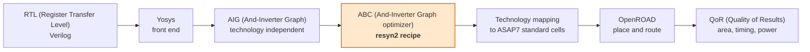
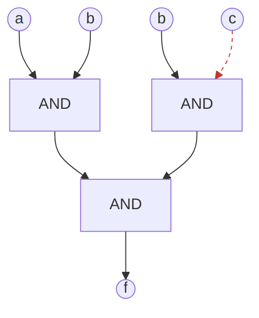
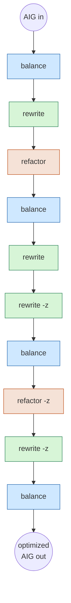
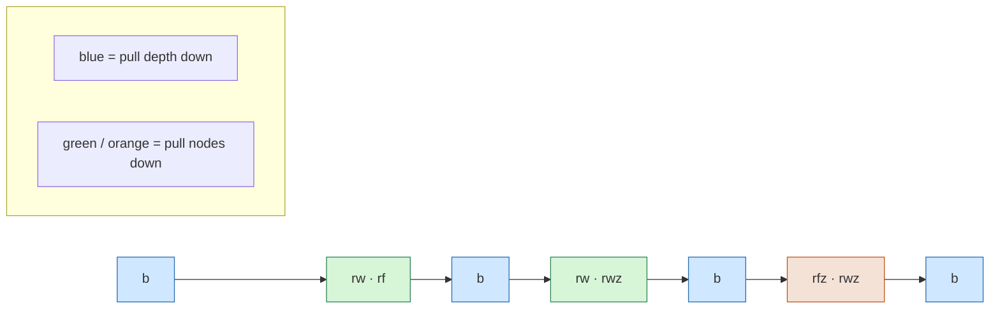

# The default flow and the default ABC (And-Inverter Graph optimizer) recipe

This document walks through the classic ABC (And-Inverter Graph optimizer)
optimization recipe, `resyn2`, which is the command space `learned-synth` searches
over.

> **Important correction about *this* flow's real default.** The OpenROAD-flow-
> scripts (ORFS) ASAP7 (Arizona State University 7nm predictive Process Design Kit)
> flow does *not* run `resyn2` by default. Its default (`abc_speed.script`) is the
> modern GIA (the scalable And-Inverter Graph engine) `&`-flow, which interleaves
> optimization and technology mapping (`&dch`, `&syn2`, `&synch2`, `&nf`,
> `&if -g -K 6`, repeated). This project deliberately works in the *classic* ABC
> command space instead (`balance`, `rewrite`, `refactor`, `resub`), because that
> is what FlowTune and DRiLLS use. So `resyn2` below is best read as the **classic
> reference recipe and baseline** our search space is built around, not as the
> string ORFS runs out of the box. See
> [harness/README.md](../harness/README.md) for how a searched classic recipe
> is injected into the flow.

## 1. Where synthesis sits in the whole flow

The design starts as RTL (Register Transfer Level) Verilog and ends as a placed
and routed layout with measurable QoR (Quality of Results). Logic synthesis is
the early stage that turns RTL into a gate netlist. The `resyn2` recipe lives
inside the ABC (And-Inverter Graph optimizer) box.



`learned-synth` changes only the highlighted box. Everything upstream and
downstream stays identical, which is what makes the comparison against the
baseline clean.

## 2. What the ABC (And-Inverter Graph optimizer) works on: the AIG

Before the recipe runs, the logic is an AIG (And-Inverter Graph): a directed
acyclic graph in which every internal node is a 2-input AND, and any edge may be
complemented (an inversion). Because every Boolean function reduces to ANDs and
inversions, this one uniform node type can represent all combinational logic.



A dashed edge marks a complemented (inverted) connection. The two numbers the
optimizer cares about are:

- **Node count**: the number of AND nodes. This is the technology-independent
  proxy for **area**.
- **Level (depth)**: the longest path in AND nodes from any input to any output.
  This is the proxy for **delay**.

The whole game of `resyn2` is trading these two numbers down.

## 3. The default recipe: `resyn2`

`resyn2` is a fixed, hand-tuned sequence of ten transformations. In ABC (And-
Inverter Graph optimizer) shorthand:

```
resyn2 = b ; rw ; rf ; b ; rw ; rwz ; b ; rfz ; rwz ; b
```

Written out, one step per box:



The colouring shows the alternation the recipe is built around: blue steps target
**depth**, green and orange steps target **node count**. Read on for what each
does.

## 4. What each transformation does

| Command | Short | Targets | What it does |
| --- | --- | --- | --- |
| `balance` | `b` | depth | Uses associativity and commutativity of AND to rebuild the AIG (And-Inverter Graph) into a shallower tree, cutting the number of logic levels. |
| `rewrite` | `rw` | nodes | Greedy cut-based rewriting: for small (about 4-input) cuts it looks up a precomputed minimal implementation and swaps it in when that reduces AND nodes. |
| `refactor` | `rf` | nodes | Like rewrite but over larger cones: it collapses a bigger cut to its Boolean function, recomputes a factored form, and rebuilds it when that reduces AND nodes. |
| `rewrite -z` | `rwz` | nodes (escape) | Rewrite that also accepts zero-gain (equal node count) swaps, reshaping the graph so later steps find new reductions. |
| `refactor -z` | `rfz` | nodes (escape) | Refactor that also accepts zero-gain swaps, for the same escape-the-local-minimum reason. |

### The two ideas that make this non-trivial

**The steps do not commute and are not idempotent.** `balance` after `rewrite`
lands on a different graph than `rewrite` after `balance`, and running `rewrite`
twice differs from running it once. If order did not matter, one pass of each
command would be optimal and there would be nothing to learn.

**The `-z` (zero-cost) trick.** Normally `rewrite` and `refactor` only accept a
local swap that strictly reduces node count. The `-z` variants also accept swaps
that leave the count unchanged. On their own these do nothing, but they move the
graph to a new shape from which the *next* `balance` or `rewrite` can find
reductions that were previously invisible. This is how a fixed sequence climbs
out of local minima, and it is why `resyn2` puts the `-z` steps in the second
half after the cheap wins are already taken.

## 5. Depth versus nodes, across the recipe

Each pass tends to help one metric while slightly hurting the other. `balance`
lowers depth but can add nodes. `rewrite` and `refactor` lower nodes but can add
depth. The recipe alternates between them so neither metric runs away.



## 6. After the recipe: technology mapping

Once `resyn2` has optimized the technology-independent AIG (And-Inverter Graph),
ABC (And-Inverter Graph optimizer) maps it onto real ASAP7 (Arizona State
University 7nm predictive Process Design Kit) standard cells, using the cell
delay and area data from the library to guide the mapping. Only after this, and
after OpenROAD place and route, do we get the real QoR (Quality of Results)
numbers.

This is the crux of the whole project: `resyn2` is tuned against the AIG proxy
metrics (nodes and depth), not against the post-place-and-route reality. A recipe
that produces a smaller AIG can still map and route to a *worse* final layout.
That gap is the opening `learned-synth` aims at.

## 7. What `learned-synth` changes

The fixed ten-step `resyn2` string is one point in the classic-command space, and
it is our baseline. Instead of one recipe for every design, we search that space
(the order, length, and choice of classic commands) and grade candidates on real
downstream QoR (Quality of Results) rather than on the AIG (And-Inverter Graph)
proxy. The searched optimization sequence is sandwiched between a fixed `strash`
prologue and a fixed mapping epilogue so the netlist stays valid for OpenROAD. See
[harness/README.md](../harness/README.md) for the injection mechanism.
