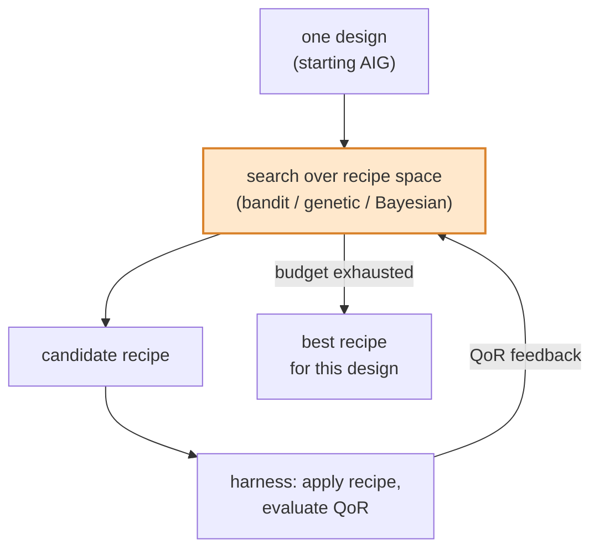
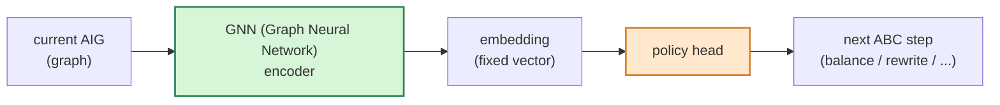
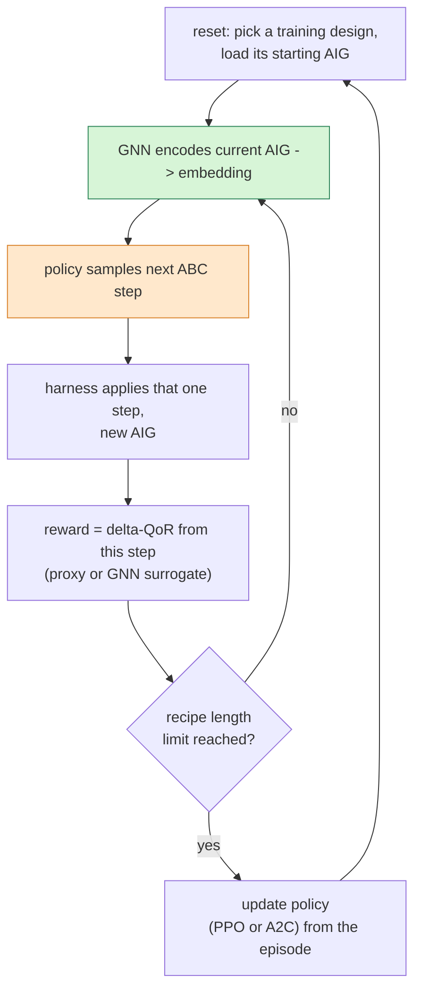
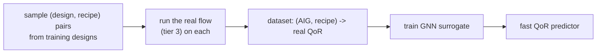
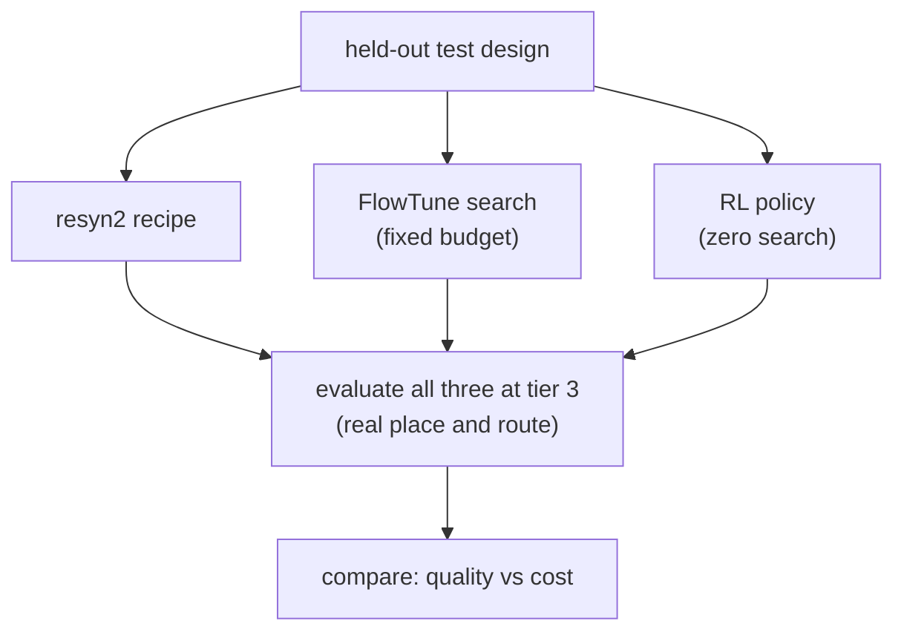

# Experiment: FlowTune search versus an RL policy with a GNN

## The question this experiment answers

Two different methods can pick a better ABC (And-Inverter Graph optimizer)
transformation sequence than the fixed `resyn2` recipe. This experiment runs both
on the same footing and measures which does better:

- **Approach A: per-design search** (FlowTune style). For each design, search the
  space of recipes directly on that design and keep the best. No learning across
  designs.
- **Approach B: a learned RL (Reinforcement Learning) policy with a GNN (Graph
  Neural Network) encoder.** Train one policy across many designs so that, given a
  new design, it emits a good recipe without searching.

FlowTune is a logic-synthesis flow autotuner (https://github.com/Yu-Maryland/FlowTune).
The RL path follows the DRiLLS approach (https://github.com/scale-lab/DRiLLS) and the
OpenABC-D dataset and GNN baselines (https://github.com/NYU-MLDA/OpenABC).

**What FlowTune gives you natively versus what you integrate.** Searching the
transformation sequence is FlowTune's whole job (a multi-armed bandit over classic
ABC commands: `balance`, `rewrite`, `refactor`, `resub`), so you do not build the
search. Its built-in objectives, however, are ABC-level proxies (AIG node count and
levels, LUT count and depth), and its only post-place-and-route integration is with
VTR (Verilog-to-Routing), an FPGA (Field-Programmable Gate Array) flow, not
OpenROAD. So the integration you add is **wiring your OpenROAD + ASAP7 (Arizona
State University 7nm predictive Process Design Kit) harness in as FlowTune's custom
objective**, so the bandit optimizes real ASIC (Application-Specific Integrated
Circuit) sign-off QoR (Quality of Results) instead of a proxy. That is the same
harness the RL side uses, so it is not duplicated work.

## "Better" has two axes, not one

This is the single most important thing to get right, or the comparison is
meaningless. The two approaches do not spend their effort in the same place:

- **Quality**: how much the chosen recipe improves QoR (Quality of Results) over
  the `resyn2` baseline.
- **Cost to answer a new design**: FlowTune pays its cost *per design at test
  time* (it must search every new design). The RL policy pays its cost *once, up
  front, in training*, and is then nearly free per new design.

So the honest framing is not "which gets better QoR" alone. It is: does the RL
policy's *instant, zero-search* recipe get close to the quality that FlowTune buys
with an expensive per-design search? If yes, the learned policy is the better tool
because it generalizes. If FlowTune wins clearly on quality, per-design search is
worth its cost. Report both axes every time.

## Shared foundation (identical for both approaches)

Both approaches sit on the same harness and are judged the same way. Only the
picker differs.

- **Harness (Rung 0)**: one command, `(design, recipe) -> QoR (Quality of
  Results)`, running Yosys, then ABC (And-Inverter Graph optimizer) with the
  recipe and technology mapping to the ASAP7 (Arizona State University 7nm
  predictive Process Design Kit) cells, then OpenROAD place and route.
- **Fixed Yosys front-end script**: the starting AIG (And-Inverter Graph) must be
  identical for a given design across every run, or the two approaches are not
  starting from the same graph. Pin it.
- **Recipe space**: the command alphabet (`balance`, `rewrite`, `refactor`, their
  `-z` variants, and so on) and a maximum recipe length. Both approaches draw from
  the exact same space.
- **QoR (Quality of Results) definition**: a single scalar figure of merit, for
  example area at matched delay, so that "better" is unambiguous and the two
  approaches optimize the same thing.
- **Design set, split by design**: a set of RTL (Register Transfer Level) designs
  split into a **training set** and a held-out **test set**. The split is across
  designs, because the whole point of Approach B is generalizing to designs it
  never trained on.
- **Baseline**: `resyn2` QoR on every design. All improvements are reported
  relative to this.

### Evaluation tiers (managing the cost of grading)

A full QoR (Quality of Results) evaluation is minutes to hours. Both approaches
need many evaluations, so use a tiered signal but always report final numbers at
the real tier:

1. **Cheap proxy**: ABC-level node count and logic depth. Fast, coarse.
2. **Surrogate**: a learned GNN (Graph Neural Network) predictor of QoR, trained
   on real place-and-route runs. Fast, more accurate than the proxy.
3. **Real sign-off**: full OpenROAD place and route. Slow, the ground truth.

The reported result for every approach is always tier 3 on the held-out test
designs. Tiers 1 and 2 are only for the inner loops that cannot afford tier 3.

## Approach A: FlowTune per-design search

No training phase and no design representation. For each design independently,
search the recipe space under a fixed budget and keep the best recipe found.

- The topology is used *implicitly*: the search never encodes the design, it just
  reads real QoR (Quality of Results) feedback from running on that design.
- The knob that makes the comparison fair is the **search budget**: the number of
  harness evaluations allowed per design. Report it.
- Cost is paid per design, every time, at test time.

## Approach B: RL policy with a GNN encoder

Train one policy across the training designs, then apply it to unseen test
designs with no search.

### Architecture

The GNN (Graph Neural Network) turns the variable-size AIG (And-Inverter Graph)
into a fixed vector the policy can read. The policy emits the next transformation.
A simpler first version can replace the GNN with hand-crafted AIG features
(node count, depth, fan-in/fan-out histograms), which is what the original DRiLLS
work did. Start there if the GNN is slowing you down, then upgrade the encoder.

### Training loop

One episode optimizes one training design, one transformation at a time.

- **Reward**: the improvement in QoR (Quality of Results) from applying a step.
  Because RL needs many steps, the inner-loop reward comes from tier 1 (proxy) or
  tier 2 (GNN surrogate), not full place and route.
- **The GNN QoR surrogate is a separate model from the policy's encoder.** One
  (the encoder) helps the policy *choose*; the other (the surrogate) supplies the
  *reward* cheaply. Do not conflate them. See below for building the surrogate.
- Training runs across the whole training set so the policy sees many topologies
  and learns which shapes want which steps.

### Building the GNN (Graph Neural Network) QoR surrogate (if used)

This is a one-time data-generation and training job that feeds the RL reward:

The same dataset is reusable: it also gives you the honest accuracy numbers for
the surrogate, and it can seed offline experiments.

## Testing protocol (the actual comparison)

Run on the **held-out test designs only**, which neither approach optimized during
training.

For each test design, produce a recipe three ways and evaluate all three at tier 3
(real place and route):

1. **`resyn2`** - the fixed baseline.
2. **FlowTune** - search that design under the fixed per-design budget.
3. **RL policy** - run the trained policy once, zero search, to emit a recipe.

Report, per design and aggregated:

- **Quality**: percent QoR (Quality of Results) improvement over `resyn2` (for
  example area at matched delay).
- **Cost to answer this design**: number of full-flow evaluations and wall-clock
  time. FlowTune's cost is its whole search budget. The RL policy's per-design cost
  is one evaluation, with the training cost reported separately and once.

## Fair-comparison rules (do not skip)

- **Same starting AIG (And-Inverter Graph)** for every approach on every design
  (pinned Yosys script).
- **Same recipe space**: identical command alphabet and maximum length.
- **Same final grader**: tier 3 real QoR (Quality of Results) for all reported
  numbers.
- **Honest budget accounting**: state FlowTune's per-design search budget and the
  RL policy's one-time training cost side by side. Do not hide either.
- **Test on designs neither approach trained or searched on** for the
  generalization claim.

## Possible outcomes and what each would mean

- **FlowTune wins on quality, loses on cost.** Per-design search finds better
  recipes but must pay for every design. Useful when you synthesize a design once
  and can afford the search.
- **RL matches FlowTune's quality at a fraction of the per-design cost.** The
  learned policy generalizes, which is the stronger result and the better tool for
  many designs.
- **Neither dominates, and a hybrid wins**: use the RL policy to warm-start
  FlowTune's search (start the search from the policy's recipe), getting most of
  the quality with a much smaller search budget. This is often the practical
  sweet spot and a good third bar to plot.

## Where this maps in the plan

This document is the experimental method for Rungs 2 through 4 of
[../PLAN.md](../PLAN.md): FlowTune is the Rung 2 search, the GNN (Graph Neural
Network) surrogate is Rung 3, and the RL (Reinforcement Learning) policy is Rung 4.
The head-to-head between them is the headline result of the project.
